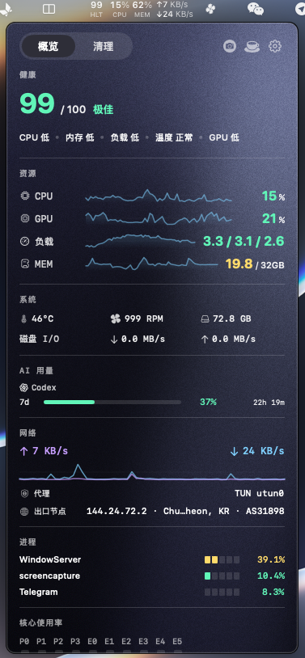
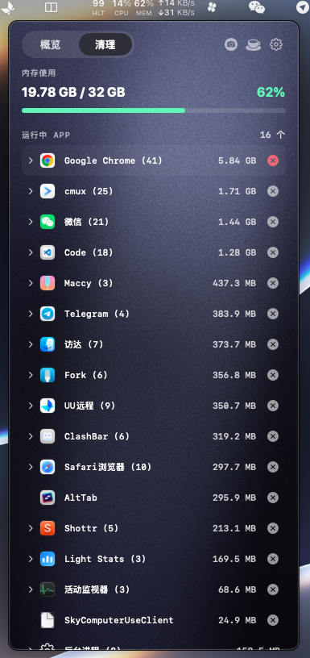
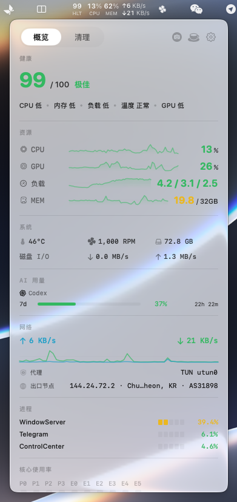
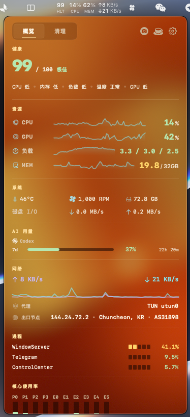
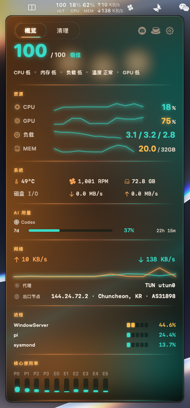

# Light Stats

[](https://github.com/EvilIrving/light-stats/actions/workflows/build.yml)
[](https://github.com/EvilIrving/light-stats/actions/workflows/release.yml)

Light Stats 是原生 macOS 菜单栏状态监控工具，衡量系统即时压力而非静态资源容量。0-100 健康分综合 CPU 饱和度、内存压力与 swap、负载均值、发热状态与 GPU 利用率，仅在系统面临性能瓶颈时扣分。按需提供 15 家 AI 订阅用量、代理与公网出口节点检测、Finder 动作、窗口管理、光标定位及外接显示器硬件亮度。仅支持 Apple Silicon（macOS 14+）。

[English](README.md) · **简体中文** · [日本語](README.ja.md) · [한국어](README.ko.md)

---

https://github.com/user-attachments/assets/f167325d-e972-42fe-a54f-17a8a7a40834

---

## 截图

干净安装默认使用「墨夜」主题，展示概览与清理：

| 概览 | 清理 |
|------|------|
|  |  |

主题（概览）：

| 经典 | 黄金时刻 | 琥珀 | 墨夜 |
|------|------|----------|------|
|  |  |  |  |

---

## 概览

Light Stats 将 Mac 的实时压力信号固定在菜单栏，并在需要更多信息时展开详细的浮动面板。专为无需长期常驻「活动监视器」即可快速了解系统状态的高级用户和开发者设计，并把 AI 编码 Agent、网络环境及 Finder 的常用工作流上下文放在手边。

常规采样均使用 macOS 原生系统 API。监控读数是只读的核心功能；其他开发者与系统工具均需在设置中手动开启。

---

## 功能

### 菜单栏

- 紧凑的双行状态项，数值固定宽度，避免布局跳动
- 可选显示 Logo、CPU、GPU、内存、磁盘、网络、风扇、电池、健康分
- 上传和下载速率显示
- 风扇状态旋转图标
- 可选显示 0-100 健康分

### 概览面板

- CPU、GPU、内存压力、交换活动和负载均值
- P/E 核心使用率图表和 CPU 进程排行
- 电池状态、电量、循环次数、健康度、功耗和温度，按机型能力显示
- 磁盘容量和聚合磁盘 I/O 速率
- 网络速率、本地代理状态和可选公网出口节点信息
- 可选外接显示器硬件亮度（默认关闭）
- 温度、风扇、热状态和磁盘状态条
- 系统健康分、各维度摘要和维度开关
- 开启 AI 监控后显示 15 家 AI 订阅用量（额度窗口与预付余额）
- 关键指标短期趋势折线
- 指标图标使用可模板染色的 SVG 轮廓（CPU、GPU、内存、磁盘、网络、代理、温度、进程）

### 外观

- 产品表面（弹窗、关于、Toast、更新窗、辅助功能引导）可选四种主题：
  - **经典**：系统仪表读数，无卡片框（macOS 26+ 为 Liquid Glass，macOS 15 为系统原生材质）
  - **黄金时刻**：暖色噪点与黄铜仪表质感，衬以琥珀色与珊瑚色光场
  - **琥珀**：浓缩咖啡色酒吧暗调，搭配温润琥珀灯光与单处冷青色霓虹点缀
  - **墨夜**（干净安装默认）：墨黑噪点与冷炭灰质感表面
- 黄金时刻、琥珀与墨夜均提供胶片颗粒开关以及五档光影动态（静止、舒缓、自然、流畅、活跃）

### 内存清理

- 内存压力概览和交换空间预警
- 按内存占用排序的 App 列表
- 正常退出和二次确认后的强制退出
- 可展开查看子进程
- 列表采用仪表读数布局：分区、发丝线、密集行

### Finder 菜单

- 可选 FinderSync 扩展，默认关闭
- 复制选中文件的路径或名称，空白处可复制当前目录路径
- 新建文本、代码及 Word、Excel、PowerPoint 文件；默认显示 TXT 与 Markdown，其他类型可在设置中勾选
- 从现有文件添加自定义模板，保留原名、格式和内容；原文件移动或删除不影响模板
- 移动或复制到常用目录，也可通过「其他位置…」临时选择目标
- 直接打开常用目录，或用所选终端、配置的 App 打开当前位置和文件
- 隐藏或取消隐藏选中项；显示隐藏文件会经确认后更改访达全局设置并重新打开访达
- 可选 cmux 窗口与工作区操作，可单独配置菜单项目
- 覆盖主目录、外接卷及添加的常用目录；云盘目录仍受其他 Finder 扩展和系统状态影响
- 设置页显示扩展注册状态，并提供重新打开访达的入口

### 窗口管理

- 单一**「窗口管理」开关**（默认关闭）同时启用菜单栏窗口控制图标、全局贴靠快捷键和标题栏手势，无单独子开关
- 基于唯一的「边缘吸附」归属选择（Light Stats 或 macOS 原生平铺），额外提供三分屏、四角吸附、自定义布局与跨显示器移动
- 菜单栏窗口控制入口，附带专属动作图标
- 左半屏、右半屏、上半屏、下半屏快捷键，覆盖高频窗口放置操作
- `Control + Option + Return` 最大化当前窗口，`Control + Option + C` 将当前窗口居中
- 菜单提供角落、三分之一、跨显示器移动、最大化、居中、还原、最小化等动作
- 标题栏触控板滑动：标题栏高度从窗口红绿灯现算，点在应用自身交互控件上不起手。按住 **Fn** 改为吸附指针下的窗口，覆盖自绘标题栏的 App
- 顶部布局岛：将窗口拖拽至屏幕顶部边缘即可呼出布局岛，快速拖入半屏、三分屏、四角、六分屏、九分屏或堆叠布局
- Dock 点击收起与恢复：点击最前台 App 的 Dock 图标收起其全部窗口，再次点击即可恢复
- 拖拽晃动隐藏其他 App：拖拽窗口时快速晃动，可隐藏所有其他应用；再次晃动即可恢复
- 边缘吸附归属为单一选项：默认由 Light Stats 负责摆放并关闭系统原生的两处平铺开关；若手动重新开启系统平铺，App 会提示冲突并提供一键修复
- 关闭开关会立即移除图标并停止所有后台监听；辅助功能权限仅在开启时请求

### 默认输入法

- 可选：切换 App 后回到选定的系统输入源
- 默认关闭，不需要辅助功能权限
- 只在 App 激活后的短窗口内纠正漂移，之后的 `Ctrl+Space` 不受影响；安全输入框从不触碰
- 单一全局默认，非输入法管理器：无按 App、按网站的规则，无指示器

### 滚动方向控制

- 垂直与水平滚动方向可独立反转
- 传统鼠标滚轮默认受控；触控板和 Magic Mouse 可显式纳入
- 可关闭滚轮加速，并将每次滚动固定为 1-10 行
- 步长倍率用于微调滚动手感
- 后台监听只在开着的时候运行，系统唤醒后按需自动恢复

### 快速定位光标与演示模式

- 自行录制触发键（左/右修饰键、Fn、F 键、普通键或组合键）：双按在全屏变暗后高亮光标，三按切换常驻演示指针
- 高光跟随光标移动，点击或按任意键后淡出，另有 4 秒安全超时；演示指针再次三按即可关闭
- 纯本地被动监听，不拦截也不改写任何系统事件，需辅助功能权限且默认保持关闭
- Pro 功能：当前赠送期内启动过 App 的用户永久获赠 Pro；正式收费版本发布后，新用户需激活码解锁（设置 → 通用）。App 保持 MIT 开源；激活码用 Ed25519 签名离线校验，零网络请求

### 清理快捷键

- 可选全局热键，在指针处打开清理页，不必点菜单栏
- 默认关闭；Carbon 热键，不需要辅助功能权限
- 默认 ⌃⌥⌘U，可自行录制

### 清洁模式

- 锁定键盘 60 秒，方便清洁键盘
- 全屏半透明遮罩与倒计时
- 仅支持鼠标点击退出，键盘输入会被抑制
- 需要辅助功能权限，锁键盘 60 秒

### 保持唤醒与登录启动

- 弹窗工具栏提供「保持唤醒」快捷开关，可阻止显示器进入睡眠，无需辅助功能权限
- 关闭工具栏开关或退出 Light Stats 时立即停止
- 登录时启动可在设置中通过 macOS 原生登录项服务配置

### 自动更新

- 手动检查或选择开启自动检查，读取 Cloudflare R2 渠道标记（`latest-stable.json` / `latest-beta.json`），GitHub Releases 作为回退；自动检查默认关闭
- 更新通道：**正式版**（仅正式发布）或 **尝鲜 / Beta**（同时纳入 `v1.9.0-beta.N` 等预发布）
- SemVer 2.0 正确比较预发布标识，beta 递增与转正可识别
- R2 下载另校验 SHA-256，再验证 codesign 签名、公证状态和 Team ID
- 应用退出后通过独立脚本替换运行中的 app bundle
- 下载和安装期间显示轻量进度窗口

### 诊断与性能记录

- 本地结构化故障日志始终开启（无关 / 仅错误 / 完整三级开关）。连续指标按时间采样；能力与探测在首次观察和状态变化时写入
- 设置中可导出诊断报告 ZIP（系统环境、硬件探测、最近 7 天日志，总上限 50 MB），序列号、凭据、用户名和完整 home 路径会脱敏，不上传至外部服务器
- 另有可选的 48 小时性能记录，只记录本软件 CPU、内存、唤醒、磁盘及配套系统负载；不写回故障日志，也不进入诊断报告

### 网络与代理

Light Stats 从环境变量、系统代理设置与活跃隧道接口检测本地代理配置，无需发送外部网络请求。

公网出口节点检测为可选功能。开启后可向所选 geo-IP 服务查询公网 IP、地理位置、ASN 与 ISP，并缓存结果以避免重复请求。

### AI 订阅用量

开启后，Light Stats 读取各 provider CLI 已保存在本地的凭据，或在设置中填入的 API token（存入钥匙串），并向对应 provider 查询当前订阅额度。AI 监控默认关闭，凭据绝不会发送给其他 provider 或 Light Stats 开发者。

Claude Code 与 Codex 各有独立的用量窗口保活开关（默认关闭）。滚动窗口重置后，通过对应 CLI 在临时空目录发送最小提示词 `ok`，丢弃常规输出，并验证新窗口。

### 健康分

健康分将 CPU、内存压力与 swap、负载均值、温度、GPU 及电源状态综合为 0-100 的数值。它衡量的是影响系统即时响应的实时压力，而非缓慢变化的容量数值。笔记本电脑的电源维度采用电池状态，台式机则采用磁盘 I/O 压力。缺失或关闭的维度会自动重新归一化分配权重。

---

## 隐私

本地系统指标、本地代理检测、进程列表、滚动行为和窗口控制均保留在 Mac 本地。各项可选网络功能发送的内容如下：

- 出口节点探测：向所选 geo-IP 服务查询公网 IP、位置、ASN 和 ISP，并将结果缓存 60 秒。
- AI 用量监控：仅使用各 CLI 已保存在本机的凭据访问对应 provider 自身的用量接口。
- 可选 Claude/Codex 保活：通过对应 CLI 发送上述最小提示词。
- 手动与自动更新检查：访问 Cloudflare R2，GitHub Releases 作为回退；下载更新后在安装前校验 SHA-256（R2）、代码签名、公证状态与 Team ID。
- 本地故障日志保存在应用程序支持目录下。导出诊断报告需由用户主动触发；性能记录为独立的 48 小时可选记录。两者均不会发送给 Light Stats 开发者。

完整说明见[隐私政策](https://evilirving.github.io/light-stats/#privacy)。

---

## 安装

从 [download.onecat.dev/stable](https://download.onecat.dev/stable)（或 [GitHub Releases](https://github.com/EvilIrving/light-stats/releases/latest)）下载最新 DMG，拖入「应用程序」即可。发布构建均已签名与公证；内置更新程序在替换应用前也会校验 SHA-256（R2）、代码签名、公证与 Team ID。

系统要求：macOS 14 或更高版本，仅支持 Apple Silicon Mac。

---

## 设置

- 视觉主题（经典、黄金时刻、琥珀、墨夜），以及黄金时刻、琥珀与墨夜的颗粒度与光影动态控制
- 菜单栏项目显示开关
- 刷新频率：低 (5s)、中 (2s)、高 (1s)
- 温度单位：摄氏度或华氏度
- 登录时启动、自动检查更新以及正式版/Beta 通道；「保持唤醒」为弹窗工具栏快捷开关
- 导出诊断报告；可选 48 小时性能记录
- 出口节点检测与服务商选择
- 15 家 AI 监控，以及 Claude/Codex 独立的用量窗口保活开关
- 垂直与水平滚动方向独立反转、可选纳入触控板与 Magic Mouse、滚轮加速开关、固定行数及步长倍率
- 切换 App 后回到选定输入法
- 清理快捷键：在指针处打开清理页，无需点击菜单栏
- 窗口管理（单一开关管理菜单栏图标、贴靠快捷键与标题栏手势）、边缘吸附归属及冲突检测
- 外接显示器硬件亮度
- Finder 菜单、终端选择、cmux 动作、常用目录、应用与文件模板
- 健康分各维度开关
- 语言：简体中文、English、日本語、한국어、跟随系统

设置侧栏提供直达入口：「通用」「监控」「输入设备」「窗口管理」「AI 用量」「右键菜单」，不显示运行状态点。

---

## 开发

详见 [CONTRIBUTING.md](CONTRIBUTING.md)。

### 环境要求

- macOS 14+，仅支持 Apple Silicon
- 推荐 Xcode 16 或更新版本
- Swift 5.9+
- 本地代码检查需要 SwiftLint (`brew install swiftlint`)

### 构建

```bash
# 生产包覆盖 /Applications/Light Stats.app 并启动
./script/local-run.sh

# Release DMG（不安装）
./script/build.sh
```

### 质量检查

```bash
swiftlint lint --strict
./script/validate_localization.sh
```

GitHub Actions 会并行运行 SwiftLint、本地化校验与 XCTest 质量检查。Pull Request 和 `main` 分支在检查通过后打包未签名 DMG。Release tag 会在签名与公证前重新运行相同检查；仅发布校验通过的公证产物。GitHub Pages 保持独立的纯文档部署流程。

### 测试

XCTest 测试套件位于 `LightStatsTests/`，已接入 Xcode 工程（共享 `Light Stats` scheme 下的 `LightStatsTests` 单元测试 target），CI 与以下命令均可运行。测试覆盖易回归的纯逻辑：`HealthScoreService` 评分曲线、默认关闭的设置约定，以及三家 AI 用量 JSON 解析器（测试数据位于 `LightStatsTests/Fixtures/`）。

```bash
xcodebuild test \
  -project "Light Stats.xcodeproj" \
  -scheme "Light Stats" \
  -destination 'platform=macOS'
```

### 技术栈

- SwiftUI 用于面板与设置
- AppKit 用于菜单栏集成、弹窗、遮罩与自定义视图
- Combine 与 Swift Concurrency
- Mach API、IOKit、Accessibility、Core Graphics event tap、CFNetwork、Network、SMC、getifaddrs

### 架构

应用按模型、服务、视图模型和视图分层。`SystemMonitor` 编排采样并向 UI 发布快照，各服务分别采集对应指标。

需要缓存或异步执行的采集器（如出口节点查询、AI 用量 provider）使用 actor；UI 绑定状态留在主 actor；快速 syscall helper 在合适场景保持同步。

### 项目结构

- `Light Stats/Models/`：指标数据结构、健康分、发布信息、`AppTheme`、吸附动作、输入源选项
- `Light Stats/Services/`：系统采集、健康评分、自动更新、滚动反转、窗口摆放与边缘吸附、快捷键、标题栏手势、键盘锁、AI 用量、Finder 菜单、显示器亮度、诊断日志
- `Light Stats/ViewModels/`：应用状态、采样编排、设置管理、清洁模式、更新协调、Finder 菜单、显示器控制
- `Light Stats/Views/StatusBar/`：菜单栏渲染
- `Light Stats/Views/Popover/`：浮动面板 UI 与复用组件
- `Light Stats/Views/Theme/`：主题 token、mesh 背景、噪点、选择器、外观预设
- `Light Stats/Views/Settings/`：设置界面
- `Light Stats/Views/About/`：关于窗口
- `Light Stats/Views/CleaningMode/`：清洁模式全屏遮罩
- `Light Stats/Views/Update/`：更新进度窗口
- `Light Stats/Views/Permission/`：主题化辅助功能引导面板
- `Light Stats/Utilities/`：格式化器、指标环形缓冲区、`SVGIcon`
- `Light Stats/Resources/`：本地化多语言字符串、窗口控制图标、指标 SVG 轮廓
- `FinderMenu/` 与 `FinderMenuExtension/`：共享 Finder 动作与 FinderSync 扩展
- `LightStatsTests/`：XCTest 测试套件（健康分、设置默认值、AI 解析器、PTY、诊断日志、窗口吸附、默认输入法、Finder 模板、SemVer）
- `.github/workflows/`：复用质量检查、打包构建、Pages 部署及签名发布流水线

---

## 路线图

- 更详细的网络诊断
- 覆盖笔记本和台式 Mac 的更多验证
- 按 App 统计网络用量
- 更细粒度的清理建议
- 持续调优主题、窗口手势与菜单栏信息密度
